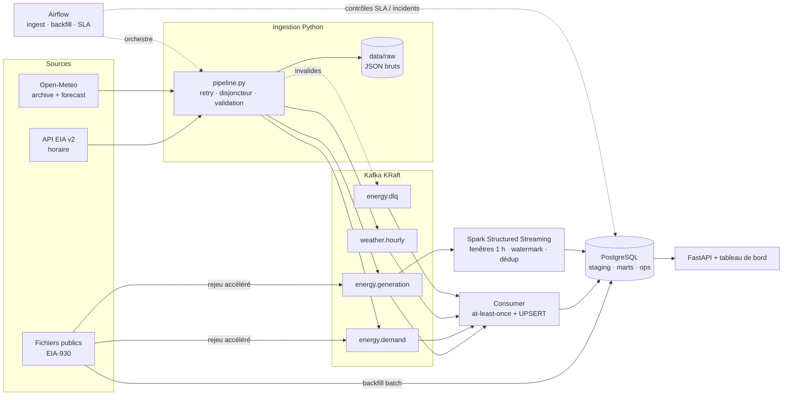

# EnergyPulse — plateforme de collecte et de supervision de données énergétiques

Plateforme **DataOps** locale qui collecte des données **réelles** de production et de demande électrique (EIA, États-Unis), les enrichit avec la **météo** (Open-Meteo), les traite en **batch** et en **streaming**, et supervise en continu la fraîcheur, la complétude et la qualité des données, avec ouverture et fermeture automatiques des incidents.

> **Périmètre** : les données de l'EIA concernent les États-Unis. Le projet suit 4 réseaux aux profils très différents : **CISO** (Californie, solaire), **ERCO** (Texas, éolien), **PJM** (nord-est, nucléaire et gaz) et **NYIS** (New York, hydraulique). Le pays n'a pas d'importance ici : ce qui compte, ce sont les compétences techniques.

    

## Questions auxquelles la plateforme répond

| Question | Où |
|---|---|
| Quelle est la production par filière (solaire, éolien, hydraulique…) ? | `GET /generation/{zone}`, `GET /generation/{zone}/mix`, tableau de bord |
| Comment le renouvelable évolue-t-il avec la météo ? | `GET /weather-correlation` (ex. corrélation solaire/rayonnement ≈ 0,86, éolien/vent au Texas ≈ 0,82) |
| Y a-t-il une baisse de production inhabituelle ? | `ops.anomalies` : z-score sur 14 jours, plus une règle solaire qui tient compte de la météo |
| Les données arrivent-elles à temps ? | `GET /sla` : fraîcheur et complétude par zone et par jeu de données |
| Que se passe-t-il si une source tombe ou envoie des données fausses ? | relances avec backoff, disjoncteur, DLQ, incidents auto, rejeu (voir [runbook](docs/runbook.md)) |

## Architecture



Détails : [docs/architecture.md](docs/architecture.md).

## Démarrage rapide

Prérequis : Docker Desktop (8 Go de RAM alloués au minimum).

```powershell
copy .env.example .env          # puis colle ta clé EIA dans .env (facultatif)
docker compose up -d --build
```

| Service | URL |
|---|---|
| API et tableau de bord | http://localhost:8030 (doc : `/docs`) |
| Airflow | http://localhost:8090 (admin / admin) |
| Kafka UI | http://localhost:8095 |
| Spark UI | http://localhost:4040 |
| PostgreSQL | `localhost:5440`, base `energypulse` |

Charger 30 jours d'historique réel, puis rejouer 24 h dans Kafka en 10 minutes :

```powershell
docker exec ep-airflow-scheduler airflow dags trigger energypulse_backfill
docker compose run --rm app python -m energypulse.pipeline replay --start 2026-11-19 --end 2026-11-19 --speed 144
```

## Ce que le projet démontre

- **Multi-source réel** : API EIA (clé gratuite), fichiers EIA-930 (sans clé), Open-Meteo (sans clé). Si l'API EIA est indisponible, le projet continue avec les fichiers.
- **Pas de faux temps réel** : l'EIA publie toutes les heures, donc l'ingestion live tourne toutes les heures. Le streaming est démontré en **rejouant de l'historique réel en accéléré**, avec les vraies dates de mesure.
- **Batch et streaming sur le même code** : les mêmes règles de parsing et de validation servent au backfill (direct PostgreSQL), au live et au rejeu (Kafka). Les totaux calculés par Spark sont identiques à ceux du batch.
- **Idempotence de bout en bout** : `event_id` déterministe, `UPSERT` sur clé naturelle, offsets Kafka validés *après* l'écriture en base. Relancer un backfill ne crée aucun doublon (vérifié).
- **Robustesse** : relances avec backoff exponentiel, disjoncteur (closed → open → half_open), DLQ, double validation (producteur et consumer), checkpoints Spark, conteneurs `restart: unless-stopped`.
- **Supervision et SLA** : fraîcheur, complétude, santé des sources, volume de DLQ et anomalies, avec des incidents dédupliqués, ouverts et résolus automatiquement.
- **Tests** : 28 tests unitaires (pytest), lint (ruff), CI GitHub Actions.

## Problèmes réels rencontrés (et corrigés)

1. **Valeurs négatives légitimes** : la première règle de validation rejetait 232 heures de CISO, où la filière « Autres » descend jusqu'à −10 GW. L'analyse a montré qu'il ne s'agissait pas de corruption : ces catégories fourre-tout incluent du stockage net. La règle a été ajustée et la part renouvelable est désormais calculée sur la production **brute** (valeurs positives), sinon elle dépassait 100 %.
2. **Watermark empoisonné** : un seul message corrompu daté de 2099, injecté par le scénario de panne, a fait avancer le watermark de Spark en 2099. Toutes les vraies données suivantes ont alors été jetées comme « en retard ». Correctif : Spark lit le topic brut, il applique donc ses propres garde-fous (zone, filière, bornes, pas de date future).
3. **Trou dans la source** : PJM n'a aucune valeur de demande pendant 25 heures le 1er novembre 2026, jour du changement d'heure aux États-Unis. Le contrôle de complétude le détecte.
4. **API EIA lente** : la clé de démonstration renvoie des erreurs 504. D'où les relances, le disjoncteur et la voie de secours par les fichiers EIA-930.

## Structure

```
ingestion/energypulse/   paquet Python : sources, validation, Kafka, base, qualité, consumer
spark/                   job Spark Structured Streaming
airflow/dags/            3 DAGs (ingestion horaire, backfill, qualité/SLA)
api/                     FastAPI + tableau de bord (Chart.js)
sql/                     schémas staging / marts / ops
scripts/chaos.py         simulation d'incidents
tests/                   tests unitaires
docs/                    architecture, runbook
```

## Limites connues

- Un seul broker Kafka (facteur de réplication 1) : c'est une plateforme de démonstration locale, pas un cluster de production.
- Les révisions de valeurs déjà publiées par l'EIA sont bien prises en compte par la couche batch (UPSERT), mais pas par Spark, qui dédoublonne sur `event_id` à l'intérieur du watermark.
- Le point météo de chaque zone est une ville représentative, pas une moyenne pondérée sur tout le réseau.
